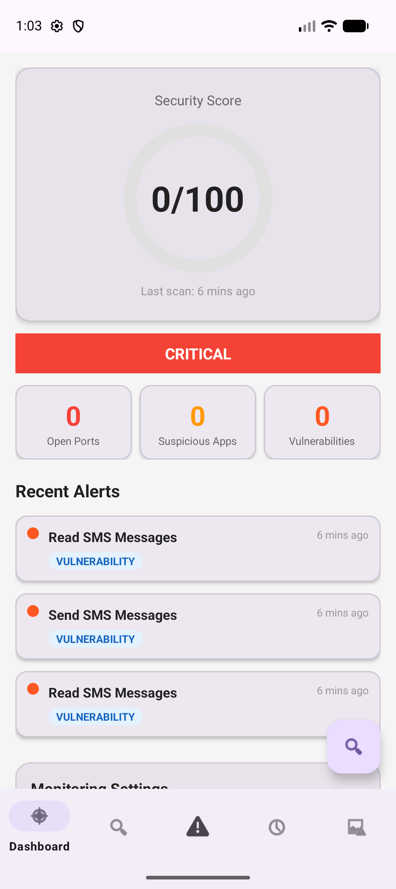
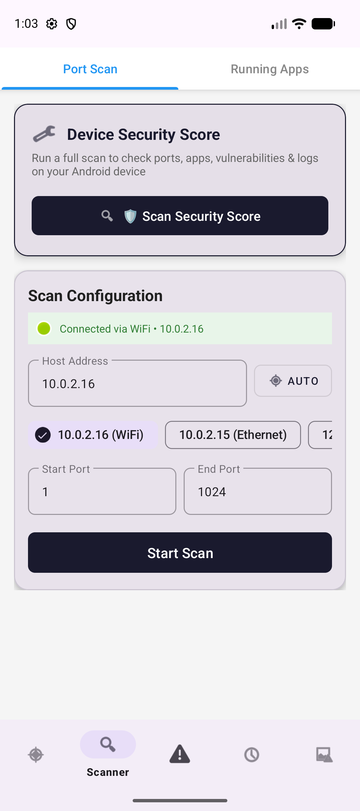
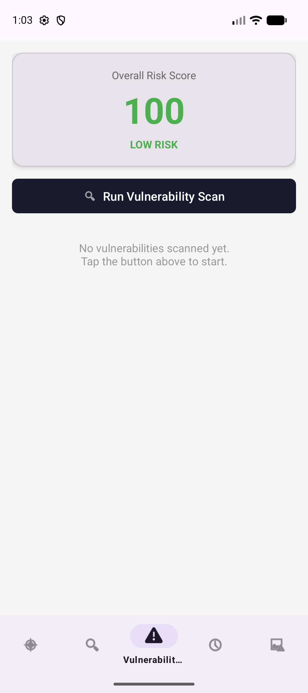
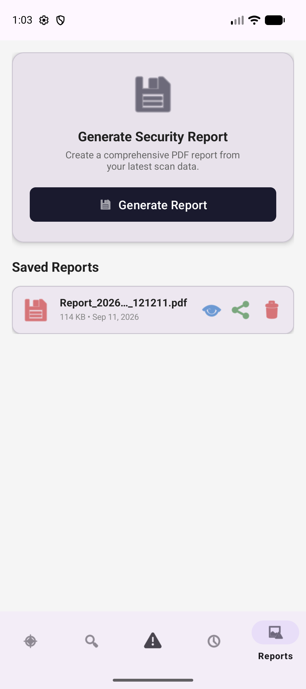

# MobileSentinel

MobileSentinel is an Android security assessment app that helps users inspect a device, understand security findings, and export scan results. It combines deterministic on-device checks with optional Gemini explanations so findings remain auditable and easy to understand.

> **Scope:** MobileSentinel is an assessment and reporting tool. It is not a replacement for a mobile antivirus product or a professional penetration test.

## What it does

- **Dashboard:** Shows the current security score, scan status, open ports, suspicious apps, vulnerabilities, and recent alerts.
- **Full security scan:** Coordinates port, running-app, vulnerability, and log checks into one device assessment.
- **Port scanner:** Scans a configurable host and port range and highlights risky open ports.
- **Running-app monitor:** Reviews running processes, memory usage, install source, and dangerous permissions.
- **Vulnerability analyzer:** Inspects installed applications for risky configurations such as debuggable builds, backup exposure, dangerous permissions, and exported components.
- **Security log analyzer:** Captures and filters security-relevant device log events.
- **AI explanations:** Optionally sends structured security evidence to Gemini for plain-language impact and remediation guidance. Rule-based analysis remains available when AI is unavailable.
- **Reports:** Generates, saves, previews, shares, and deletes PDF security reports.
- **Background monitoring:** Supports periodic scans and foreground notifications for ongoing monitoring.

## Screenshots

| Dashboard | Scanner | Vulnerabilities |
|:---:|:---:|:---:|
|  |  |  |

| Reports |
|:---:|
|  |

The screenshots above were captured from the debug build running on an Android emulator.

## How it works

1. **Collect:** Android framework APIs gather package metadata, permissions, running-app information, network indicators, and relevant logs.
2. **Analyze:** `SecurityRiskEngine` applies deterministic rules and weighted scoring to the collected evidence.
3. **Explain:** Findings can be summarized locally or enriched with Gemini using only the structured evidence supplied by the app.
4. **Persist:** Scan history and report metadata are stored locally with Room.
5. **Report:** The latest results can be exported as a PDF or JSON-oriented scan data for review.

## Tech stack

- Kotlin and Jetpack Android components
- Material UI and ViewBinding
- Room for local persistence
- Hilt for dependency injection
- Coroutines and WorkManager for background work
- Google Generative AI SDK for optional Gemini explanations
- Android PDF/document APIs for report generation

## Requirements

- Android Studio Ladybug or newer
- JDK 17
- Android SDK 35
- Android device or emulator running Android 7.0 (API 24) or newer

## Build and run

1. Clone the repository and open it in Android Studio:

   ```bash
   git clone https://github.com/adarshvardhannn/MobileSentinel.git
   cd MobileSentinel
   ```

2. Create `local.properties` from `local.properties.example` and set your local Android SDK path.
3. Build and install the debug app:

   ```bash
   ./gradlew assembleDebug
   ./gradlew installDebug
   ```

   On Windows, use `gradlew.bat` instead of `./gradlew`.

## Optional Gemini setup

AI explanations are optional. To enable them, create `local.properties` locally and add a key from [Google AI Studio](https://aistudio.google.com/):

```properties
gemini.api.key=YOUR_GEMINI_API_KEY_HERE
```

`local.properties` is ignored by Git and must never be committed. If a key is exposed, revoke it immediately in Google AI Studio and create a replacement. The app can still provide rule-based explanations without a Gemini key.

## Privacy and permissions

The app is designed for local device assessment. It requests permissions needed for network inspection, package/process visibility, notifications, foreground monitoring, and log analysis. Only structured security evidence is sent to Gemini when the optional AI feature is used; personal files, contacts, and photos are not uploaded by the app.

Some Android versions restrict access to usage statistics, logs, and package visibility. Grant the relevant access in Android settings when prompted, and interpret results within those platform limitations.

## Project status

The current debug build is functional across the dashboard, scanner, vulnerability, logs, reports, background monitoring, and optional AI explanation flows. Device-specific permissions and network conditions can affect scan coverage, and security findings may require manual verification.

## License

MobileSentinel is released under the [MIT License](LICENSE).
